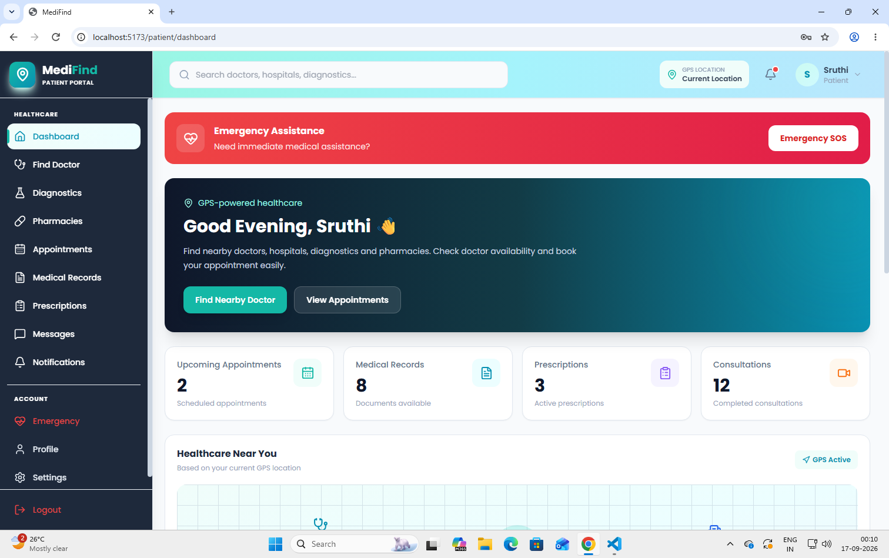
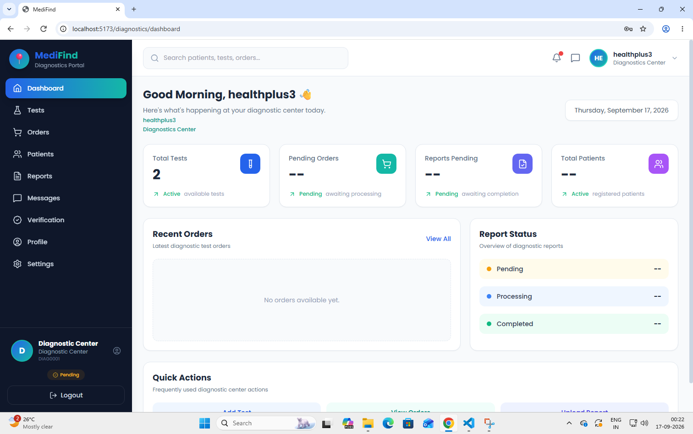
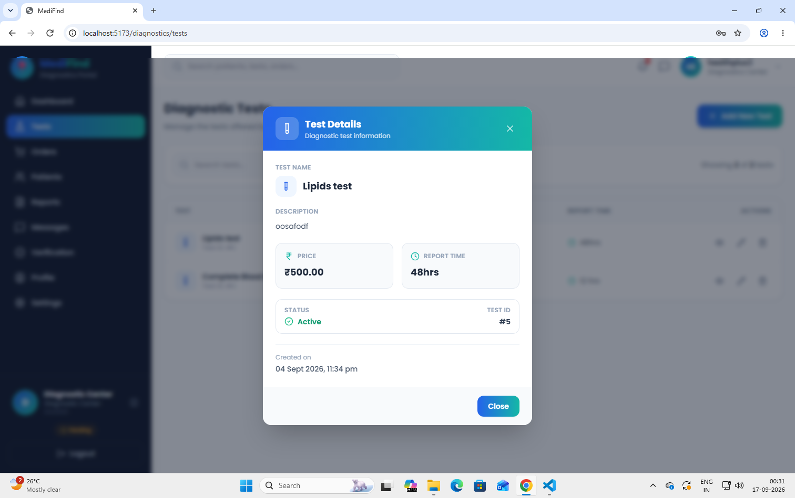
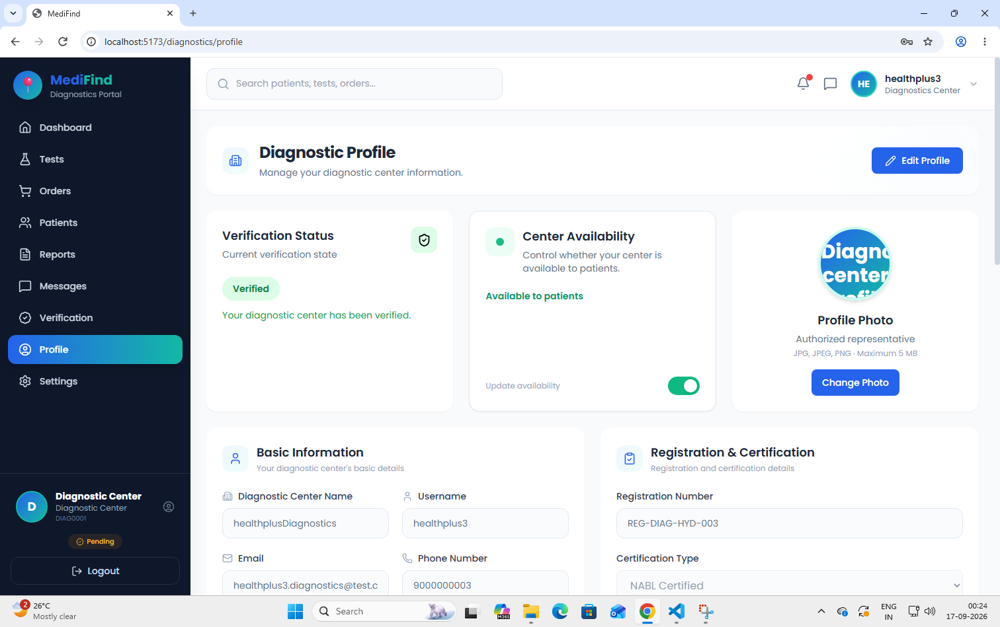
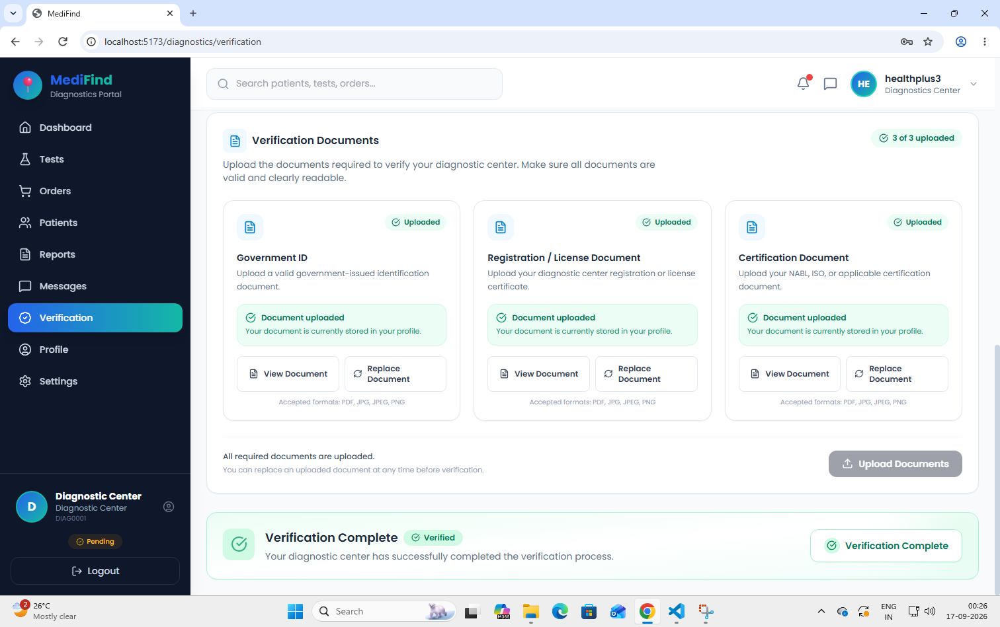
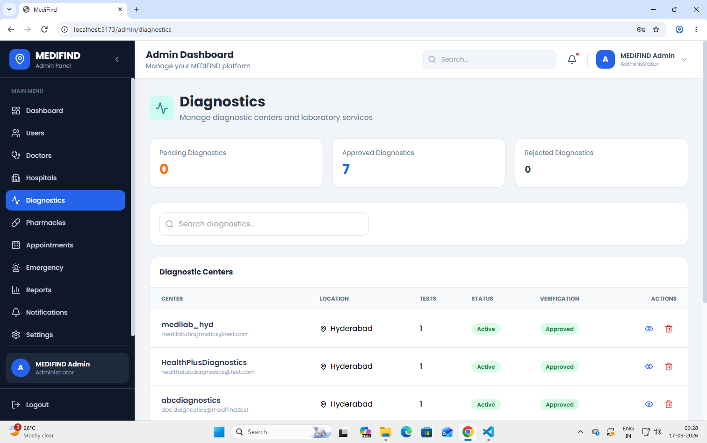
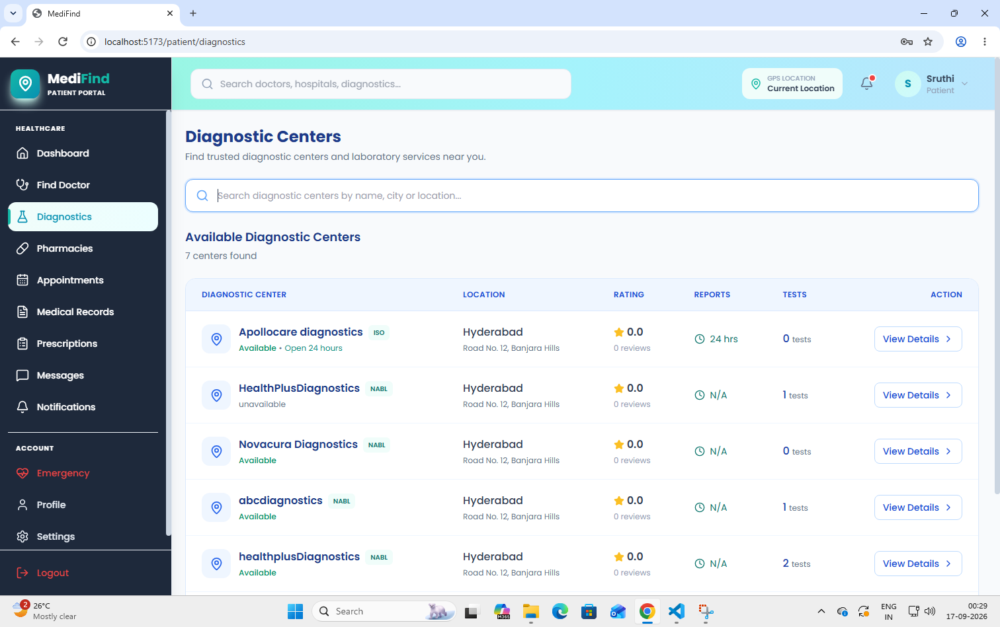

# MEDIFIND

A full-stack healthcare platform designed to connect patients with healthcare providers and support healthcare-related workflows across patients, doctors, diagnostic centers, pharmacies, and administrators.

MEDIFIND uses a **Django REST Framework backend** and a **React frontend**, with JWT-based authentication and role-based access control.

---

## Overview

MEDIFIND is a multi-role healthcare platform that provides separate workflows for:

* Patients
* Doctors
* Diagnostic centers
* Pharmacies
* Administrators

The backend exposes REST APIs for authentication, patient services, healthcare-provider management, diagnostics, pharmacy workflows, and administrative operations.

The frontend provides role-specific dashboards and interfaces for interacting with these services.

---

## Key Features

### 🔐 Authentication & Authorization

* JWT-based authentication using Django REST Framework Simple JWT
* Access and refresh token workflow
* Role-based authentication
* Role-specific authorization and permissions
* Token blacklisting during logout
* Password reset and forgot-password workflows
* Authentication throttling
* Protected API endpoints

### 👤 Patient Features

* Patient dashboard
* Healthcare-provider discovery
* Patient-specific authenticated workflows
* Role-based access to patient resources
* Real-time messages and notifications via Websockets

### 🩺 Doctor Features

* Doctor profiles
* Doctor verification workflows
* Role-specific doctor access
* Protected doctor APIs
* Real-time messages and notifications via Websockets

### 🧪 Diagnostics Features

* Diagnostic-center registration and authentication
* Diagnostic-center profiles
* Verification workflows
* Role-based diagnostic-center authorization
* Patient listing for diagnostic centers
* Administrative verification and rejection workflows
* Real-time messages and notifications via Websockets

### 💊 Pharmacy Features

* Pharmacy registration
* Pharmacy-specific authentication and permissions
* Verification workflows
* Protected pharmacy APIs

### 🛡️ Administrative Features

* Administrative authentication
* User and provider management
* Doctor and diagnostic-center verification
* Pharmacy verification
* Role-specific administrative APIs

---

## UI Preview









---

## My Contributions

My work on MEDIFIND focused primarily on the **patient-facing interface, diagnostics workflows, and authentication infrastructure**.

### Patient Dashboard

* Developed the patient dashboard UI
* Implemented the patient-facing interface and associated frontend behavior

### Diagnostics

* Implemented the diagnostics-related functionality across the application
* Worked on diagnostic-center workflows and interfaces
* Integrated diagnostics into the application's broader role-based architecture
* Implemented real-time patient-diagnostician messaging and notifications

### Role-Based Authentication

* Modified the authentication architecture to integrate diagnostics into the shared role-based authentication system
* Worked with role-specific authentication and authorization behavior
* Integrated diagnostic-center users with the application's centralized authentication identity

### JWT Token Handling

* Modified authentication behavior to address access-token expiration
* Worked on the access-token refresh flow so authenticated users can maintain their sessions when short-lived access tokens expire

---

## Technology Stack

### Backend

* Python
* Django
* Django REST Framework
* Django REST Framework Simple JWT
* drf-spectacular / OpenAPI
* SQLite for development

### Frontend

* React
* Vite
* React Router
* Axios
* Tailwind CSS
* Framer Motion
* Recharts
* React Hot Toast
* Lucide React
* Font Awesome

### API & Security

* REST APIs
* JWT Bearer authentication
* Role-based access control
* Permission classes
* Authentication throttling
* Token refresh and blacklisting

---

## System Architecture


                    ┌──────────────────────┐
                    │     React Frontend   │
                    │  Vite + Tailwind CSS │
                    └──────────┬───────────┘
                               │
                               │ REST / JSON
                               ▼
                    ┌──────────────────────┐
                    │    Django REST API   │
                    │        + DRF         │
                    └──────────┬───────────┘
                               │
              ┌────────────────┼────────────────┐
              │                │                │
              ▼                ▼                ▼
        Authentication     Role-Based       Application
          & JWT            Permissions       Workflows
              │                │                │
              └────────────────┼────────────────┘
                               │
                               ▼
                    ┌──────────────────────┐
                    │       Database       │
                    │        SQLite        │
                    └──────────────────────┘

---

## Authentication & Role-Based Access Control

MEDIFIND uses a centralized authentication model based on a custom user identity.

Users are assigned roles such as:

USER
DOCTOR
DIAGNOSTICS
PHARMACY
HOSPITAL
ADMIN

The authenticated role is used to determine which resources and operations the user can access.

The backend implements dedicated permission classes for different roles, including:

* `IsAdmin`
* `IsDoctor`
* `IsDiagnostics`
* `IsPharmacy`
* `IsRegularUser`
* `IsVerifiedPharmacy`

JWT authentication is integrated with the application's role model so that protected endpoints can enforce both authentication and authorization requirements.

---

## JWT Token Management

The application uses access and refresh tokens for authenticated API requests.

The authentication flow supports:

1. User login
2. Access-token issuance
3. Authenticated API requests
4. Access-token refresh
5. Token expiration handling
6. Logout and token blacklisting

The frontend also handles access-token expiration and refresh behavior to maintain authenticated sessions without requiring unnecessary user re-authentication.

---

## REST API

The backend provides REST APIs covering:

* Authentication
* User registration
* Patient services
* Doctor workflows
* Diagnostics workflows
* Pharmacy workflows
* Administrative operations

An OpenAPI schema is included in:

medifind-backend/schema.yml

The schema documents the REST API and its JWT-protected endpoints.

---

## Testing

The backend contains automated tests covering authentication, authorization, registration, logout, throttling, password-reset workflows, and diagnostic-center permissions.

Examples include tests for:

* Successful and unsuccessful login
* User registration
* Duplicate registration attempts
* Password validation
* Role-based permissions
* Administrative access
* JWT logout/token blacklisting
* Authentication throttling
* Forgot-password workflow
* Password-reset workflow
* Diagnostic-center authorization
* Diagnostic-center verification and rejection

---

## Local Development

### Backend

Create and activate a Python virtual environment, install the dependencies, and run the Django development server.

```bash
cd medifind-backend
python -m venv venv
pip install -r requirements.txt
python manage.py migrate
python manage.py runserver
```

### Frontend

```bash
cd medifind-frontend
npm install
npm run dev
```

The frontend communicates with the backend through the configured API base URL.

---

## Environment Variables

Sensitive configuration is intentionally excluded from version control.

Create a local `.env` file based on:

medifind-backend/.env.example
medifind-frontend/.env.example

Example frontend configuration:

VITE_API_BASE_URL=http://localhost:8000/api

The actual `.env` files are ignored by Git.

---

## Security Considerations

The repository is configured to exclude development and sensitive files from version control, including:

* `.env` files
* SQLite databases
* Virtual environments
* `node_modules`
* Uploaded media
* Python cache files
* Coverage artifacts
* Build artifacts

Environment-variable templates are provided through `.env.example` files without exposing actual credentials.

JWT authentication and role-specific permission classes are used to protect application resources.

---

## Current Status

MEDIFIND is an **actively developing full-stack project**.

The application is currently under development, with ongoing work across the Django REST backend and React frontend for additional features such as GPS integration, messages and appointments. Current functionality includes multi-role authentication, role-based authorization, healthcare-provider workflows, diagnostics functionality, administrative APIs, automated tests, and an OpenAPI API schema.
